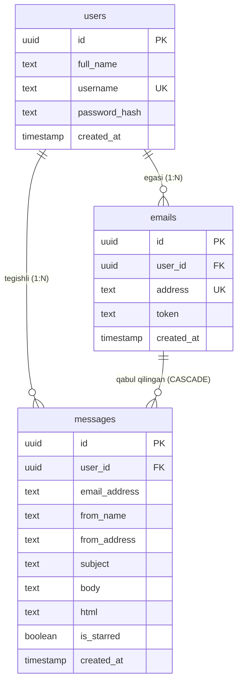

# ⚡ TekinMail

> **Dunyo darajasidagi vaqtinchalik pochta (Disposable Email) infratuzilmasi.**
> Cloudflare Email Routing & Workers, Vercel Serverless Functions va Supabase PostgreSQL asosida qurilgan, 100% real vaqtda xat qabul qiluvchi ochiq kodli tizim.

[](https://bombaclat.uz)
[](https://tekinmail.vercel.app)
[](https://supabase.com)
[](#)

---

## 📑 Mundarija (Table of Contents)

1. [Tizim Arxitekturasi (System Architecture)](#-tizim-arxitekturasi)
2. [Asosiy Imkoniyatlar (Key Features)](#-asosiy-imkoniyatlar)
3. [Texnologik Stek (Tech Stack)](#-texnologik-stek)
4. [Ma'lumotlar Bazasi Modeli (Database Schema)](#-malumotlar-bazasi-modeli)
5. [To'liq O'rnatish Qo'llanmasi (Step-by-Step Setup)](#-toliq-ornatish-qollanmasi)
   * [1-bosqich: Supabase ma'lumotlar bazasini sozlash](#1-bosqich-supabase-malumotlar-bazasini-sozlash)
   * [2-bosqich: Vercel'ga deploy qilish](#2-bosqich-vercelga-deploy-qilish)
   * [3-bosqich: Cloudflare DNS va Email Routing](#3-bosqich-cloudflare-dns-va-email-routing)
   * [4-bosqich: Cloudflare Email Worker yaratish va ulash](#4-bosqich-cloudflare-email-worker-yaratish-va-ulash)
6. [MIME va Quoted-Printable Parsing Muhandisligi](#-mime-va-quoted-printable-parsing-muhandisligi)
7. [API Hujjatlari (API Reference)](#-api-hujjatlari)
8. [Xavfsizlik va Maxfiylik (Security)](#-xavfsizlik-va-maxfiylik)

---

## 🏛️ Tizim Arxitekturasi

TekinMail an'anaviy og'ir SMTP serverlar (Postfix/Exim/Dovecot) o'rniga zamonaviy **Serverless & Edge** arxitekturasidan foydalanadi:

```text
       [ Tashqi Xizmatlar: Claude.ai / OpenAI / Google / Telegram ]
                                      │
                                      │ (1. SMTP Port 25 orqali xat jo'natish)
                                      ▼
                        [ Cloudflare MX Serverlari ]
             (route1.mx.cloudflare.net / route2... / route3...)
                                      │
                                      │ (2. Spam filtr, SPF/DKIM tekshiruvi)
                                      ▼
                      [ Cloudflare Email Routing ]
                       (Catch-all Rule: *@bombaclat.uz)
                                      │
                                      │ (3. Raw MIME stream uzatish)
                                      ▼
                      [ Cloudflare Email Worker ]
                       (tekinmail-receiver.workers.dev)
                                      │
                                      │ (4. HTTP POST JSON Webhook)
                                      ▼
                      [ Vercel Serverless Backend ]
                      (POST /api/incoming-email)
                                      │
              ┌───────────────────────┴───────────────────────┐
              │                                               │
   (5. MIME & Quoted-Printable                     (6. Foydalanuvchi va Email
      Dekodlash, Clean Text,                         mavjudligini tekshirish,
      HTML & Rich Content)                           CASCADE jadvallarga yozish)
              │                                               │
              └───────────────────────┬───────────────────────┘
                                      │
                                      ▼
                         [ Supabase PostgreSQL DB ]
                     (Jadvallar: users, emails, messages)
                                      │
                                      │ (7. Real-time Polling & API Sync)
                                      ▼
                          [ TekinMail Frontend ]
                    (Toza JavaScript, 1-screen UX,
                     Native HTML Email Frame, No Sandbox blocks)
```

---

## ✨ Asosiy Imkoniyatlar

* **100% Jonli Xat Qabul Qilish:** Tashqi dunyodagi istalgan xizmatdan (Claude, ChatGPT, GitHub, Google, va boshqalar) xatlar 0.5–1 soniya ichida yetib keladi.
* **Cheksiz Virtual Emaillar (+1 Add):** Foydalanuvchi bir tugma bilan o'ziga yangi `@bombaclat.uz` prefiksli manzil yaratishi mumkin.
* **Haqiqiy 1:1 Vizual HTML Email Ko'rinishi:** Xatlar xom kod emas, xuddi Apple Mail yoki Gmail kabi rasmlar, logolar, shriftlar va bosiladigan havolalar bilan original ko'rinishida ochiladi.
* **Toza Snippetlar:** Quoted-printable (`=3D`, `=\n`) va HTML teglar avtomatik tozalanib, inbox ro'yxatida chiroyli qisqa matn ko'rsatiladi.
* **Cross-Origin Rasmlarni To'siqsiz Yuklash:** `<meta name="referrer" content="no-referrer">` va `referrerpolicy="no-referrer"` integratsiyasi orqali korporativ serverlar (masalan `claude.ai`) rasmlarni bloklamaydi.
* **Doimiy 2-Sekundlik Silky Splash Screen:** Ilova yuklanganda zamonaviy pulsatsiyalanuvchi dark intro.
* **Skeleton Loading:** Ma'lumotlar kelguncha qotib qolish o'rniga silliq shimmiring skeletlar.
* **Bazadan Butunlay O'chirish (Tasdiqlash bilan):** Kartadagi `X` hover orqali paydo bo'ladi, tasdiqlash modali ochiladi va bazadan xatlar bilan birga o'chiriladi.

---

## 🛠️ Texnologik Stek

| Qatlam | Texnologiya | Vazifasi |
|---|---|---|
| **Edge & DNS** | Cloudflare Email Routing | Domen boshqaruvi, DDoS himoya, MX va SPF qabuli |
| **Email Worker** | Cloudflare Workers (V8 Edge) | Kelgan xom SMTP MIME xatini ushlash va Webhook yuborish |
| **Backend API** | Node.js (Vercel Serverless) | Autentifikatsiya, MIME dekodlash, ma'lumotlar sanitizatsiyasi |
| **Ma'lumotlar Bazasi** | Supabase (PostgreSQL) | Foydalanuvchilar, pochta manzillari va xabarlar saqlash |
| **Frontend** | Vanilla JavaScript (ES6+), CSS3 | High-performance, kutubxonasiz, qat'iy 1-screen responsive dizayn |

---

## 🗄️ Ma'lumotlar Bazasi Modeli

Supabase PostgreSQL arxitekturasi:



---

## 🚀 To'liq O'rnatish Qo'llanmasi

### 1-bosqich: Supabase ma'lumotlar bazasini sozlash
1. [supabase.com](https://supabase.com) ga kiring va yangi loyiha yarating.
2. **SQL Editor** bo'limiga kiring va loyihadagi [`supabase-schema.sql`](./supabase-schema.sql) skriptini to'liq yurgizing.
3. Loyiha sozlamalaridan (`Project Settings ➔ API`) quyidagi kalitlarni nusxalang:
   * **Project URL** (`SUPABASE_URL`)
   * **Service Role Key** (`SUPABASE_SERVICE_ROLE_KEY`) yoki **Anon Key** (`SUPABASE_ANON_KEY`)

---

### 2-bosqich: Vercel'ga deploy qilish
1. Repozitoriyani GitHub'ga yuklang:
   ```bash
   git push origin main
   ```
2. [vercel.com](https://vercel.com) da repozitoriyani ulang.
3. **Environment Variables** bo'limiga quyidagilarni kiriting:
   * `SUPABASE_URL` = `https://<sizning-loyiha>.supabase.co`
   * `SUPABASE_SERVICE_ROLE_KEY` = `<sizning-service-role-key>`
   * `MAIL_DOMAIN` = `bombaclat.uz`
4. **Deploy** tugmasini bosing (Ilova `https://tekinmail.vercel.app` manzilida ishga tushadi).

---

### 3-bosqich: Cloudflare DNS va Email Routing
1. Cloudflare boshqaruv panelida `bombaclat.uz` domenini oching.
2. **DNS ➔ Records** bo'limidan barcha eski `MX` va eski `TXT` (SPF) yozuvlarini o'chiring.
3. Chap menyudan **Email ➔ Email Routing** bo'limiga kiring.
4. **"Onboard Domain"** (yoki **"Enable Email Routing"**) tugmasini bosing:
   * Cloudflare taklif qilgan 3 ta yangi MX yozuvini (`route1.mx.cloudflare.net`, `route2...`, `route3...`) va SPF yozuvini tasdiqlang.

---

### 4-bosqich: Cloudflare Email Worker yaratish va ulash
1. Cloudflare bosh menyusidan **Workers & Pages ➔ Create application ➔ Create Worker** bosing.
2. Nomiga: `tekinmail-receiver` deb yozing va **Deploy** bosing.
3. **Edit code** tugmasini bosib, repozitoriyadagi [`cloudflare-worker.js`](./cloudflare-worker.js) kodini qo'ying:

```javascript
export default {
  async email(message, env, ctx) {
    try {
      const to = (message.to || '').toLowerCase().trim();
      const from = message.from || '';
      const subject = message.headers.get('subject') || 'No Subject';
      const fromName = message.headers.get('from') || from;

      // Xatning to'liq xom matnini o'qish
      const rawText = await new Response(message.raw).text();

      let bodyText = '';
      const splitBody = rawText.split(/\r?\n\r?\n/);
      if (splitBody.length > 1) {
        bodyText = splitBody.slice(1).join('\n\n');
      } else {
        bodyText = rawText;
      }

      // TekinMail Vercel API backendiga yuborish
      const targetApiUrl = env.TEKINMAIL_API_URL || 'https://tekinmail.vercel.app/api/incoming-email';

      const res = await fetch(targetApiUrl, {
        method: 'POST',
        headers: {
          'Content-Type': 'application/json'
        },
        body: JSON.stringify({
          to: to,
          from: from,
          from_name: fromName,
          subject: subject,
          raw: rawText,
          body: bodyText,
          html: ''
        })
      });

      console.log('TekinMail Forward Status:', res.status);
    } catch (err) {
      console.error('Error forwarding email:', err);
    }
  }
};
```
4. **Save and deploy** bosing.
5. `bombaclat.uz` domeniga qaytib, **Email ➔ Routing rules ➔ Catch-all rule** ni tahrirlang:
   * **Action:** `Send to a Worker`
   * **Worker:** `tekinmail-receiver`
   * **Status:** `Active / Enabled`
   * **Save** bosing.

---

## 🔬 MIME va Quoted-Printable Parsing Muhandisligi

SMTP protokoli orqali keladigan zamonaviy xatlar (Anthropic, Google, va h.k.) Quoted-Printable formatida uzatiladi:
* `=3D` belgisi aslida `=` belgisini bildiradi;
* Satr oxiridagi `=\r\n` (soft line break) satr uzilishini bildiradi;
* Sarlavhalar `=?UTF-8?B?...?=` yoki `=?UTF-8?Q?...?=` ko'rinishida kodlangan bo'ladi.

TekinMail [`api/incoming-email.js`](./api/incoming-email.js) va [`public/app.js`](./public/app.js) da ikki bosqichli intellektual parser ishlaydi:
1. **Multipart Extraction:** Boundary belgisi orqali `text/html` va `text/plain` bloklarini ajratadi.
2. **Quoted-Printable Decoding:** Barcha kodlangan belgilarni sof UTF-8 ga o'tkazadi (shu sababli Claude.ai magic linklari buzulmasdan, toza ishlaydi).
3. **Cross-Origin Image Unblocking:** Ko'pgina xavfsizlik tizimlari (masalan `claude.ai`) tashqi saytlardan rasmlar chaqirilganda `Referer` boshlig'ini tekshiradi va bloklaydi. TekinMail iframe ichiga `<meta name="referrer" content="no-referrer">` va har bir `` tegiga `referrerpolicy="no-referrer"` parametrlarini kiritib, barcha rasmlarni 100% to'siqsiz ochilishini ta'minlaydi.

---

## 📡 API Hujjatlari

### `POST /api/incoming-email`
Cloudflare Worker orqali kelgan xatlarni qabul qilib, Supabase bazasiga saqlovchi ichki webhook.

**Body (JSON):**
```json
{
  "to": "claude@bombaclat.uz",
  "from": "no-reply@anthropic.com",
  "from_name": "Anthropic",
  "subject": "Your secure link to Claude.ai is here",
  "raw": "...to'liq MIME matni...",
  "body": "Xat matni...",
  "html": "<html>...</html>"
}
```

**Response (200 OK):**
```json
{
  "success": true,
  "message": {
    "id": "e4b6c8d2-...",
    "email_address": "claude@bombaclat.uz",
    "subject": "Your secure link to Claude.ai is here"
  }
}
```

### `POST /api/delete-email`
Foydalanuvchining ma'lum bir email manzilini va unga kelgan barcha xatlarini bazadan butunlay o'chirish.

**Headers:**
`Authorization: Bearer <session_token>`

**Body (JSON):**
```json
{
  "address": "claude@bombaclat.uz"
}
```

---

## 🔒 Xavfsizlik va Maxfiylik

1. **Begona manzillarni rad etish:** Agar kelgan xat manziliga tizimda hech qaysi foydalanuvchi ega bo'lmasa, xat bazaga yozilmaydi (`404 Recipient address not found in system`).
2. **Izolyatsiyalangan Iframe:** Xat HTML kodi tizimning o'ziga ta'sir qilmasligi uchun maxsus izolyatsiyalangan `<iframe>` konteynerida render qilinadi.
3. **Session Tokenlar:** Parollar `sha256` orqali heshlanadi, soxtalashtirishdan himoyalangan Base64 session tokenlar ishlatiladi.

---

## 👨‍💻 Muallif & Litsenziya

* **Loyiha muallifi:** [Muhammadrasul Qosimov](https://github.com/mrdevs2011) (`@mrdev`)
* **Litsenziya:** MIT License — ochiq kodli va erkin foydalanish mumkin.
